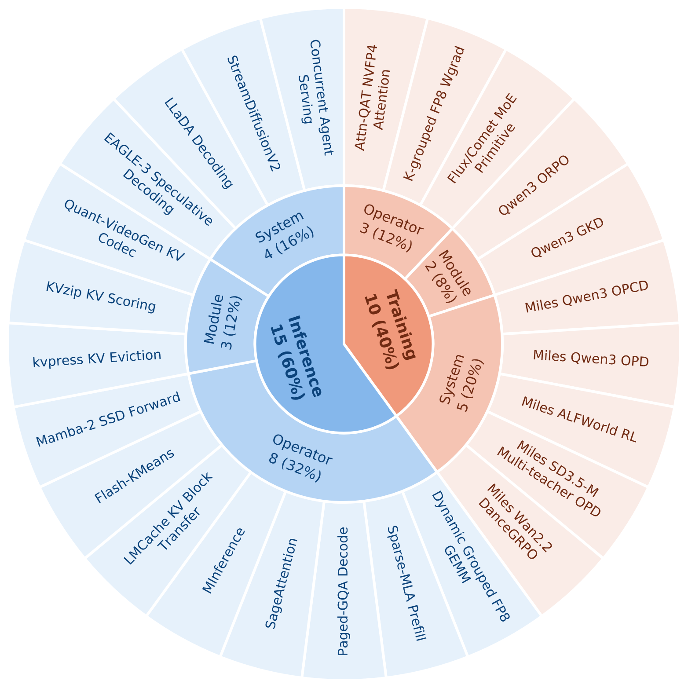
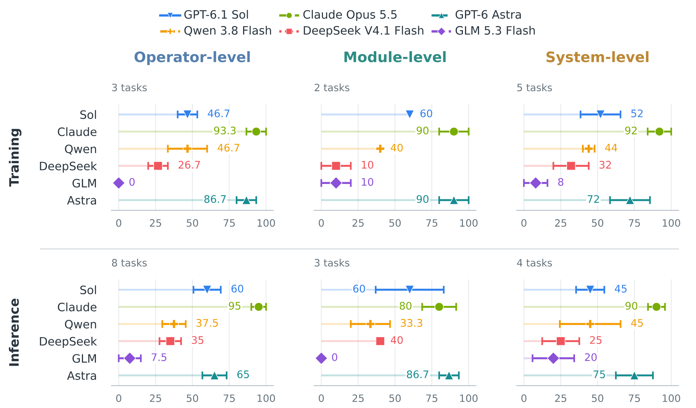
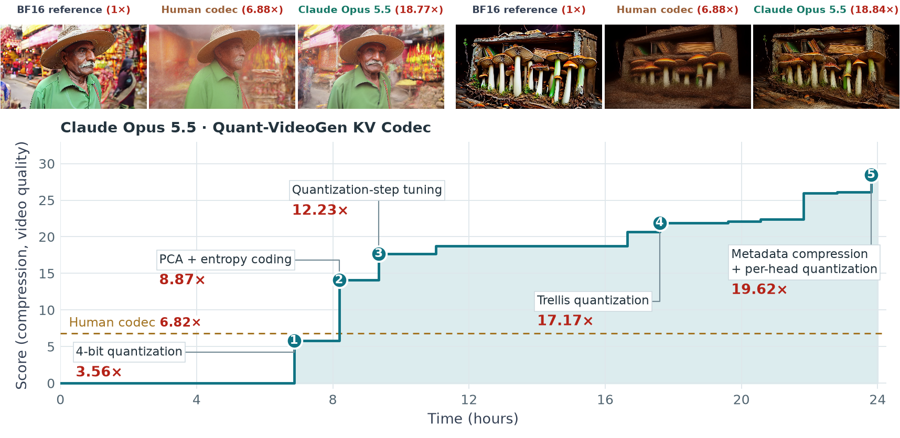
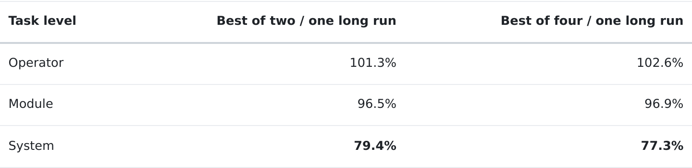

# Infrathon LinkedIn Post

> Publishing note (not part of the post): linked `@Name` labels below identify the correct individual and organization profiles. In LinkedIn, type `@` and select the matching member or Page from the suggestions to create each mention. Pasting Markdown or plain text does not create mentions. See [LinkedIn mention instructions](https://www.linkedin.com/help/linkedin/answer/a525082/mention-people-in-your-posts) and the [author account reference](author-social-accounts.md).

Can long-horizon agents keep improving real-world AI infrastructure?

In collaboration with [@Ai2](https://www.linkedin.com/company/allen-ai/), [@RadixArk](https://www.linkedin.com/company/radixark/), and [@Pyromind Dynamics Inc.](https://www.linkedin.com/company/pyromind-dynamics-inc/), we introduce Infrathon, a benchmark of 25 real-world tasks across operators, modules, and complete training or serving workflows. Built with human experts using Infrathon-build, the tasks give agents 12–24 hours to implement, profile, and test solutions.

Public tests guide development, while a Controller checks instruction following and reward hacking before private evaluation.

We evaluate six models across 150 runs, with over 10,000 GPU-hours. Three findings:

**1️⃣ Claude Opus 5.5 leads all six models.**

Claude wins 17 of 25 tasks with a mean rank score of 91.2. GPT-6 Astra follows at 75.2, winning six tasks.

**2️⃣ Infrathon can support knowledge discovery.**

On Quant-VideoGen KV Codec, Claude increases mean KV-cache compression from 6.82× to 19.86× compared with the human codec, averaged across WorldScore and MovieGen. Video quality improves on both datasets: higher mean PSNR and SSIM, and lower mean LPIPS.

Claude's codec transforms residuals using principal component analysis and applies entropy coding after quantization.

**3️⃣ Long Horizon vs. Short Horizon.**

At equal GPU-hour budgets, we compare one long run with the best of two or four shorter runs, using GPT-6 Astra and Claude Opus 5.5 on six tasks.

Longer horizons are more effective for module and system tasks, while short-horizon scaling remains competitive on operators. The long run wins nine of 12 task–model comparisons, including all four system comparisons.

Homepage: <https://infrathonx.github.io/>

Blog: <https://infrathonx.github.io/blog.html>

Code: <https://github.com/InfrathonX/Infrathon>

Paper: <https://arxiv.org/abs/2611.11995>

Hugging Face: <https://huggingface.co/datasets/Infrathon/Infrathon>

Docker Hub: <https://hub.docker.com/r/infrathon/infrathon>

Huge thanks to the entire Infrathon author team: Zhengyu Hu, [@Zheyuan Xiao](https://www.linkedin.com/in/zheyuan-xiao-5a03b2195/), [@Yike Wang](https://www.linkedin.com/in/yikee/), [@Hamish Ivison](https://www.linkedin.com/in/hamish-ivison-6a17a1118/), [@Haoyu Wang](https://www.linkedin.com/in/haoyu-alex-wang-a66149116/), Yige Yuan, [@Rulin Shao](https://www.linkedin.com/in/rulin-shao-966435191/), [@Yuetai Li](https://www.linkedin.com/in/yuetai-li-81a000309/), Niqi Lyu, Yicheng Ding, [@Shu Yang](https://www.linkedin.com/in/shu-yang-ba3739265/), [@Zhichen Zeng](https://www.linkedin.com/in/zhichen-zeng/), [@Banghua Zhu](https://www.linkedin.com/in/banghua-zhu-171902aa/), [@Jiaxin Pei](https://www.linkedin.com/in/jiaxin-pei-632b07147/), [@Kaize Ding](https://www.linkedin.com/in/kaize-ding-605a44109/), [@Pradeep Dasigi](https://www.linkedin.com/in/pradeepdasigi/), [@Dan Roth](https://www.linkedin.com/in/dan-roth-8667361/), [@Hannaneh Hajishirzi](https://www.linkedin.com/in/hanna-hajishirzi-83359816b/), [@Noah A. Smith](https://www.linkedin.com/in/noah-smith-0322511a4/), [@Teng Xiao](https://www.linkedin.com/in/teng-xiao-598176298/), and [@Radha Poovendran](https://www.linkedin.com/in/rpoovendran/)!

Thanks also to the human experts who helped build Infrathon!

Questions and feedback are welcome.

If you find Infrathon interesting, we’d appreciate an upvote on Hugging Face Daily Papers to help more people discover the work!

<https://huggingface.co/papers/2611.11995>
