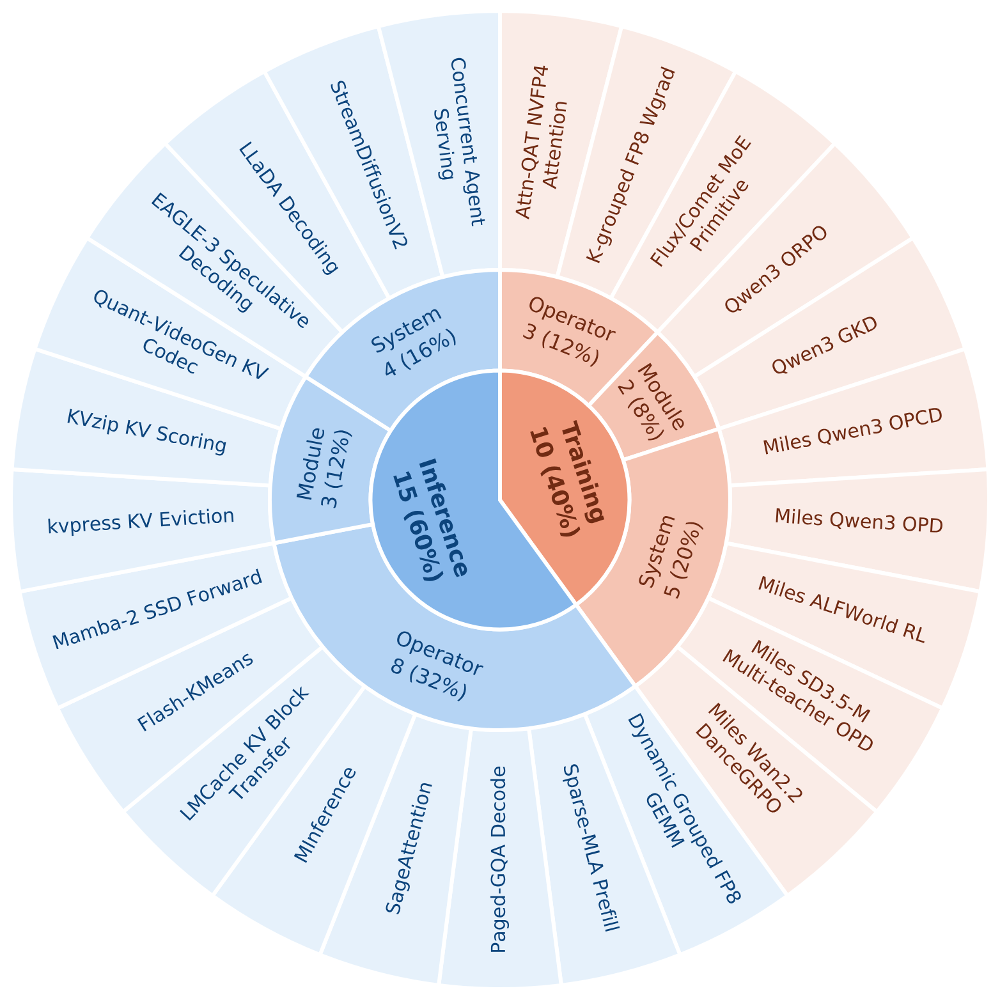
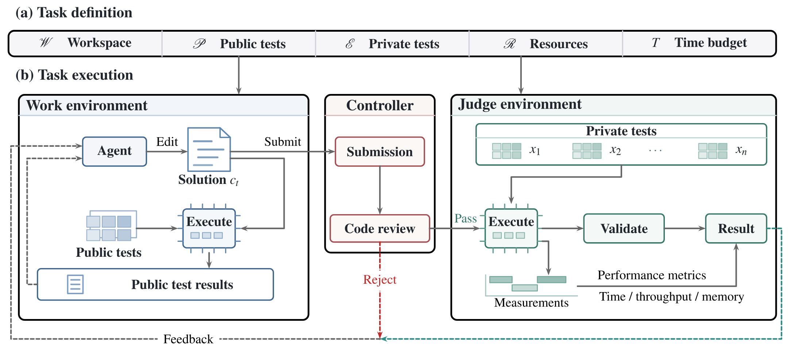
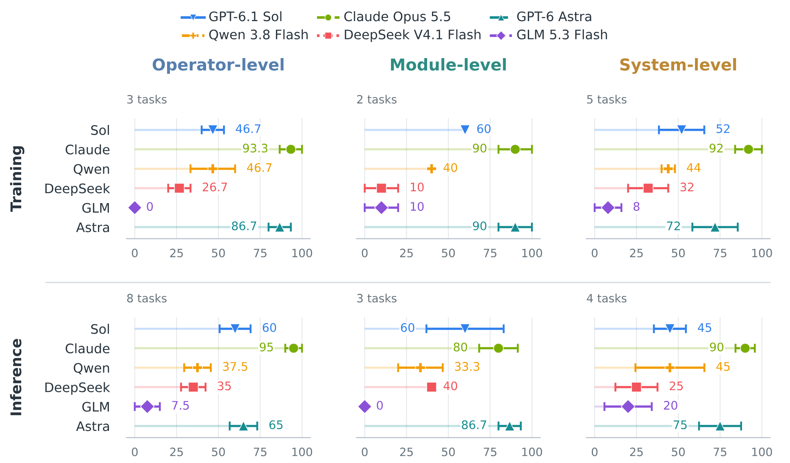
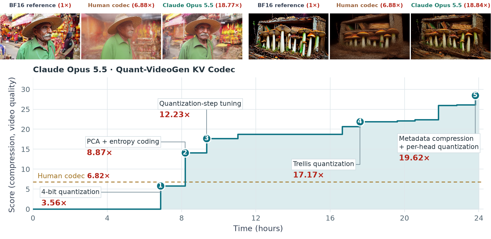
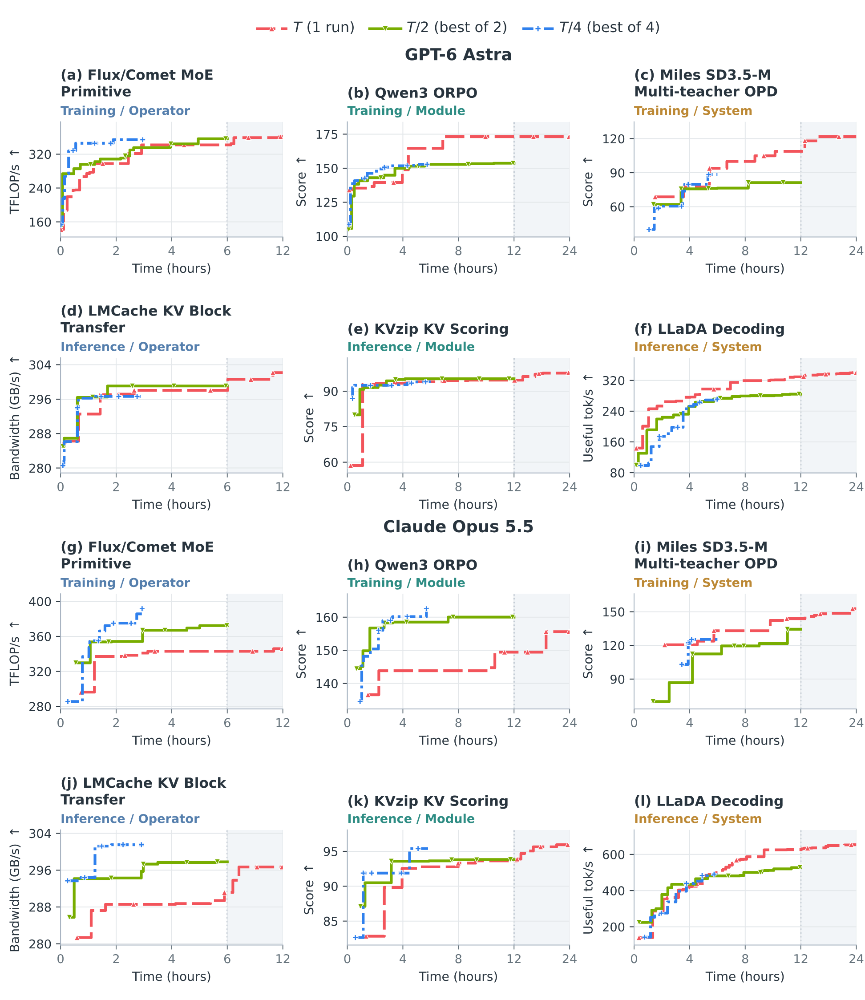

# Infrathon Twitter Thread

This file preserves the eight-post structure, research results, lists, and tables from `twitter.html`. The opening post adds a question and collaborating organizations; the closing post credits all 21 authors with verified X handles and links to Hugging Face Daily Papers. See the [account reference](author-social-accounts.md).
Attachment notes and download links after each post are publishing instructions. Download the PNGs and attach them as media when posting on X.
Before posting, replace **@[PYROMIND_X_HANDLE]** with Pyromind Dynamics' official X handle.
Most posts exceed the standard 280-character limit. This file preserves the complete long-form draft without splitting posts. [Posting on X](https://help.x.com/en/using-x/how-to-post).

## Image downloads

[Download all PNGs (ZIP)](https://raw.githubusercontent.com/InfrathonX/InfrathonX.github.io/main/assets/img/twitter/infrathon-twitter-images.zip)

| Post | Attachment | PNG |
| --- | --- | --- |
| [2/7] | Task categories | [Download](https://raw.githubusercontent.com/InfrathonX/InfrathonX.github.io/main/assets/img/twitter/task-categories.png) |
| [3/7] | Infrathon framework | [Download](https://raw.githubusercontent.com/InfrathonX/InfrathonX.github.io/main/assets/img/twitter/framework.png) |
| [4/7] | Model rankings | [Download](https://raw.githubusercontent.com/InfrathonX/InfrathonX.github.io/main/assets/img/twitter/model-rankings.png) |
| [5/7] | Codec comparison and optimization trajectory | [Download](https://raw.githubusercontent.com/InfrathonX/InfrathonX.github.io/main/assets/img/twitter/knowledge-discovery.png) |
| [6/7] | Long vs. short horizons | [Download](https://raw.githubusercontent.com/InfrathonX/InfrathonX.github.io/main/assets/img/twitter/long-vs-short.png) |
| [5/7] | Compression and video quality | [Download](https://raw.githubusercontent.com/InfrathonX/InfrathonX.github.io/main/assets/img/twitter/knowledge-discovery-metrics.png) |
| [6/7] | Long- vs. short-run performance ratios | [Download](https://raw.githubusercontent.com/InfrathonX/InfrathonX.github.io/main/assets/img/twitter/horizon-comparison.png) |

Posts [5/7] and [6/7] each include a table PNG that can replace the Markdown table when posting.
All PNGs are smaller than 5 MB. [X image upload guidance](https://help.x.com/en/using-x/posting-gifs-and-pictures).

---

## Opening post

**Can long-horizon agents keep improving real-world AI infrastructure?**

In collaboration with [@allen_ai](https://x.com/allen_ai), [@radixark](https://x.com/radixark), and Pyromind Dynamics (**@[PYROMIND_X_HANDLE]**), we introduce **Infrathon**, a benchmark of **25 real-world AI infrastructure tasks** across operators, modules, and complete training or serving workflows, with **12–24-hour** budgets.

**Claude Opus 5.5 increases KV-cache compression from 6.82× to 19.86× with better video quality**, and longer runs outperform short-run scaling on module and system tasks.

Homepage: <https://infrathonx.github.io/>

Blog: <https://infrathonx.github.io/blog.html>

Code: <https://github.com/InfrathonX/Infrathon>

Paper: <https://arxiv.org/abs/2611.11995>

Hugging Face: <https://huggingface.co/datasets/Infrathon/Infrathon>

Docker Hub: <https://hub.docker.com/r/infrathon/infrathon>

---

## [1/7]

**Can Frontier Agents Solve Diverse, Long-Horizon AI Infrastructure Tasks?**

AI infrastructure optimization requires repeated implementation, profiling, and testing. Agents must preserve correctness, recover from failed experiments, and keep searching when early attempts stall.

Existing evaluations often focus on specific components or shorter runs. We introduce **Infrathon** to study whether frontier agents can keep improving real-world AI infrastructure over **12–24 hours**.

---

## [2/7]

We construct **25 real-world tasks** with human experts using **Infrathon-build**, drawing on open-source infrastructure and research projects:

- **11 operator-level tasks** optimize computational primitives with **12-hour** budgets.
- **5 module-level tasks** optimize interacting components with **24-hour** budgets.
- **9 system-level tasks** optimize end-to-end training or serving workflows with **24-hour** budgets.

Tasks use metrics like **TFLOP/s** without fixed upper bounds.

> Media attachments (not part of the post text): [Task categories PNG](https://raw.githubusercontent.com/InfrathonX/InfrathonX.github.io/main/assets/img/twitter/task-categories.png)

---

## [3/7]

Infrathon supports continuous optimization through three components:

- **Work:** agents develop solutions and run public tests.
- **Controller:** checks instruction following and reward hacking before accepting solutions for private evaluation.
- **Judge:** runs private tests in a separate environment and returns results.

Agents use the feedback to revise their code and continue optimizing within the time budget.

> Media attachments (not part of the post text): [Infrathon framework PNG](https://raw.githubusercontent.com/InfrathonX/InfrathonX.github.io/main/assets/img/twitter/framework.png)

---

## [4/7]

**1️⃣ Claude Opus 5.5 leads all six models with a mean rank score of 91.2.**

Across **150 runs** covering all **25 tasks**, with over **10,000 GPU-hours**, Claude wins **17 tasks**. GPT-6 Astra follows with a mean rank score of **75.2** and **six task wins**.

Because tasks use different metrics, we aggregate within-task ranks with equal task weights.

> Media attachments (not part of the post text): [Model rankings PNG](https://raw.githubusercontent.com/InfrathonX/InfrathonX.github.io/main/assets/img/twitter/model-rankings.png)

---

## [5/7]

**2️⃣ Infrathon can support knowledge discovery.**

On **Quant-VideoGen KV Codec**, Claude increases mean KV-cache compression from **6.82× to 19.86×** compared with the human codec, averaged across WorldScore and MovieGen. Video quality also improves on both datasets: **higher PSNR and SSIM, and lower LPIPS**.

| Dataset / video model | Compression (×) ↑ | PSNR (dB) ↑ | SSIM ↑ | LPIPS ↓ |
| --- | --- | --- | --- | --- |
| WorldScore / HY-WorldPlay | 6.75 → **20.89** | 31.15 → **36.33** | 0.923 → **0.975** | 0.059 → **0.023** |
| MovieGen / LongCat-Video | 6.88 → **18.83** | 23.67 → **26.95** | 0.836 → **0.884** | 0.126 → **0.085** |

Mean values: Human → Claude. Quality metrics use the uncompressed BF16 reference.

The human codec quantizes residual values individually after clustering. Claude transforms the residuals using **principal component analysis** and applies **entropy coding after quantization**.

> Media attachments (not part of the post text): [Codec comparison and optimization trajectory PNG](https://raw.githubusercontent.com/InfrathonX/InfrathonX.github.io/main/assets/img/twitter/knowledge-discovery.png) · [Compression and video quality PNG](https://raw.githubusercontent.com/InfrathonX/InfrathonX.github.io/main/assets/img/twitter/knowledge-discovery-metrics.png)

---

## [6/7]

**3️⃣ Long Horizon vs. Short Horizon**

We compare one long run with the best of two or four independent shorter runs at **equal GPU-hour budgets**, using GPT-6 Astra and Claude Opus 5.5 on six tasks.

**Longer horizons are more effective for module and system tasks, while short-horizon test-time scaling remains competitive on operators.**

| Task level | Best of two / one long run | Best of four / one long run |
| --- | --- | --- |
| Operator | 101.3% | 102.6% |
| Module | 96.5% | 96.9% |
| System | **79.4%** | **77.3%** |

Geometric means of task–model score ratios. 100% means equal performance at equal total GPU-hours.

The long run wins **nine of 12 task–model comparisons**, including **all four system comparisons**.

> Media attachments (not part of the post text): [Long vs. short horizons PNG](https://raw.githubusercontent.com/InfrathonX/InfrathonX.github.io/main/assets/img/twitter/long-vs-short.png) · [Long- vs. short-run performance ratios PNG](https://raw.githubusercontent.com/InfrathonX/InfrathonX.github.io/main/assets/img/twitter/horizon-comparison.png)

---

## [7/7]

Questions and feedback are welcome!

Huge thanks to the entire Infrathon author team: Zhengyu Hu ([@ZhengyuHu477](https://x.com/ZhengyuHu477)), Zheyuan Xiao, Yike Wang ([@yikewang_](https://x.com/yikewang_)), Hamish Ivison ([@hamishivi](https://x.com/hamishivi)), Haoyu Wang ([@Haoyu_Wang_97](https://x.com/Haoyu_Wang_97)), Yige Yuan ([@1t4chiii](https://x.com/1t4chiii)), Rulin Shao ([@RulinShao](https://x.com/RulinShao)), Yuetai Li ([@yuetai12575](https://x.com/yuetai12575)), Niqi Lyu, Yicheng Ding, Shu Yang ([@shuyhere](https://x.com/shuyhere)), Zhichen Zeng ([@zz30gs](https://x.com/zz30gs)), Banghua Zhu ([@banghuaz](https://x.com/banghuaz)), Jiaxin Pei ([@jiaxin_pei](https://x.com/jiaxin_pei)), Kaize Ding ([@kaize0409](https://x.com/kaize0409)), Pradeep Dasigi ([@pdasigi](https://x.com/pdasigi)), Dan Roth ([@DanRothNLP](https://x.com/DanRothNLP)), Hannaneh Hajishirzi ([@HannaHajishirzi](https://x.com/HannaHajishirzi)), Noah A. Smith ([@nlpnoah](https://x.com/nlpnoah)), Teng Xiao ([@TengX6](https://x.com/TengX6)), and Radha Poovendran ([@RadhaPoovendran](https://x.com/RadhaPoovendran))!

Thanks also to the human experts who helped build Infrathon!

If you find Infrathon interesting, we’d appreciate an upvote on Hugging Face Daily Papers to help more people discover the work!

<https://huggingface.co/papers/2611.11995>

---
